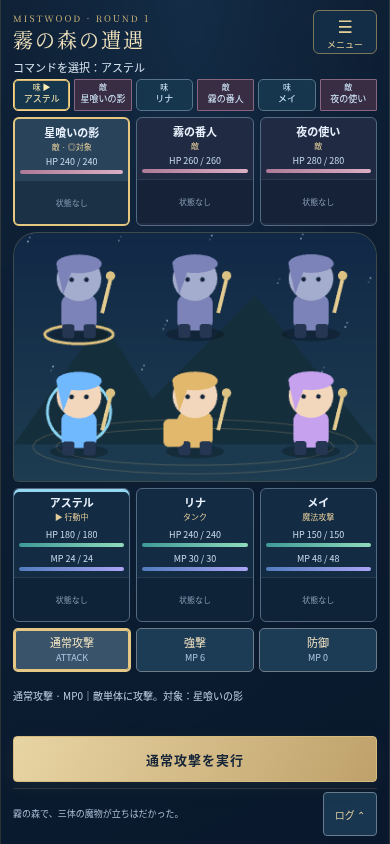

# 通常戦闘UI v0.5

## 変更ファイル

|ファイル|内容|
|---|---|
|`src/main.ts`|通常戦闘を専用ビューへ接続。既存の戦闘開始・タイマー・入力ロック・勝敗保存を維持。描画領域のリサイズとSDタップを接続|
|`src/battle-view.ts`|通常戦闘画面、HP/MP、コマンド、対象、状態詳細・メニュー・ログのダイアログ、数値演出|
|`src/battle-presentation.ts`|表示理由・バッジ・確定行動順・イベント由来の演出ラベル・状態通知。戦闘を変更しない純粋な表示処理|
|`src/battle-ui.css`|通常戦闘に限定した縦画面レイアウト、タップ領域、セーフエリア、低モーション対応|
|`src/visuals.ts`|既存SD図形の待機・強調・前進/復帰・被弾・回復・暗転、レスポンシブ描画とタップ判定|
|`tests/battle-presentation.test.ts`|表示用ロジックの追加自動テスト16件|
|`tests/battle-ui.fixture.html` / `tests/battle-ui.fixture.ts`|本番に含めない独立したUI統合テスト画面|
|`tests/battle-ui.e2e.mjs`|タッチ操作での表示・対象・理由・演出・連打・3画面幅テスト|
|`tests/browser.e2e.mjs`|既存の全通常戦闘シナリオを維持し、行動順とメニュー経由撤退の操作先だけを新UIに合わせる|
|`package.json`|`test:ui`コマンド追加（外部依存追加なし）|
|`README.md` / `docs/BATTLE_UI_V05.md`|仕様・起動/検証方法・実機確認手順|
|`docs/images/battle-ui-v05.png`|390×844pxの通常戦闘画面（レビュー用）|

`src/battle.ts`、`src/balance.ts`、`src/effects.ts`、`src/types.ts`、`src/data/`、`src/progression.ts`、`src/save.ts`は変更しません。v0.4の`lab.ts`/`lab-session.ts`/検証テスト、Vite設定、Pagesワークフロー、ロックファイルも維持します。



## 画面構成

390×844pxを基準に、上から以下を配置します。

1. ラウンド・場所名・メニュー、行動者、行動順チップ。
2. 敵3体の対象カード（HP・状態詳細・選択表示）。
3. 敵とアステル/リナ/メイのSD図形。敵カードだけでなく図形のタップでも選択可能。
4. 味方3人のHP/MP数値・ゲージ、行動中/戦闘不能、状態詳細ボタン。
5. 通常攻撃・固有スキル・共通防御を1段に配置。MP消費・説明・対象・使用不可理由、実行ボタン。
6. 直近行動の簡易ログと詳細ログボタン。

基準画面では重要情報と実行ボタンがスクロールなしに収まります。320/390/430px幅を対象にします。320×568pxなど高さが小さい場合は縦スクロールで全操作を維持し、横スクロールは発生させません。メニュー・状態詳細・ログはダイアログで開閉し、通常画面の占有を抑えます。

敵・味方は色に加えて「味/敵」の文字とチップの形で区別。現在の行動者は枠・マーカー・文字で強調します。行動順は実際の確定済みキューを参照し、未確定の次ラウンド予測を確定順として表示しません。演出中は実際に実行したイベントの行動者を示し、モデルが次ラウンドへ進んだ場合は「次はROUND」を表示します。戦闘不能者はチップから除外します。

## 操作・状態詳細

- 敵カード/敵SDをタップ → コマンド → 「○○を実行」。コマンドを先に選ぶ操作も可能です。
- ヒール・かばうでは味方カード/味方SDを選択。自己かばう・戦闘不能者は選択不可。ヒールは傷ついた味方を初期候補にし、満タン対象への実行は理由を表示して禁止します。
- 通常攻撃・スキル・防御はデータ定義に従い、現在行動者のコマンドのみ表示。MP不足・沈黙・行動不能・回復対象なし等はボタン直下と説明欄で理由を確認できます。無効操作でMP・機会を消費しません。
- 状態詳細は44px高の独立ボタン。状態異常7種、攻/防/速の強化・弱体、ガード/かばうをコンパクトに表示し、多数の場合は先頭3個と追加件数を表示します。詳細ダイアログには名称・補正量・残り行動回数を全件表示します。
- メニューから「撤退する（敗北）」を実行可能。メニューを開いても戦闘タイマーは停止しません。既存の撤退・再戦時のタイマー取消とセッション識別を維持します。
- 通常ログは実イベント由来の行動者→対象・コマンド・結果を短く表示。詳細は通常の戦闘ログのみ（最大100行）で、v0.4の検証専用診断ログとは分離しています。

## 演出と差し替え

生存者は軽い上下動、行動者は青い強調、対象は金の枠/マーカー。攻撃/ミス時は前進して復帰し、被弾は短い点滅、回復は緑の光、戦闘不能は暗転と文字表示を行います。

数値は`BattleEvent.amount`をそのまま表示。通常ダメージは白、会心は金、回復は緑。`critical`からCRITICAL、`affinity`からWEAK/RESIST、実際のミスラベルからMISSを表示します。状態の実際の増減を比較して短い付与/解除通知を出します。会心・相性・回復量を表示側で再計算しません。

攻撃時の移動・被弾点滅・回復発光・数値表示は700ms以内を基本にし、ゲームの既存演出待ち850msは変更しません。OSの「動きを減らす」設定では上下動・前進・点滅・数値移動を停止し、数値と静かな回復表示を残します。

正式画像は追加していません。既存の`Unit.texture`とPhaserのpreloadを利用して画像へ差し替えられます。図形も画像も同じコンテナ内で表示し、同じ強調・タップ領域・演出を使います。可変の描画高さに合わせて座標とキャンバス解像度を調整し、CSSだけで縮めた際のタップ位置のずれを防ぎます。

## テスト

```sh
npm test
npm run build
npm run preview
```

別ターミナルで既存の4本を実行します（プレビューが別ポートを選んだ場合はBASE_URLを合わせます）。

```sh
BASE_URL=http://localhost:4173 npm run test:browser
BASE_URL=http://localhost:4173 npm run test:foundation
BASE_URL=http://localhost:4173 npm run test:modifiers
BASE_URL=http://localhost:4173 npm run test:lab
```

新規UIテストは、別ターミナルで`npm run dev`を起動し、以下を実行します。

```sh
UI_TEST_URL=http://localhost:5173 npm run test:ui
```

Chromiumが必要です（既定`/usr/bin/chromium`、`CHROMIUM_PATH`で変更可能）。テスト専用HTML/TSはVite開発サーバーだけで読み込み、`dist/`には含まれません。通常ゲームにテスト用のグローバルAPIやスイッチを追加していません。

追加テストは、現在行動者とコマンド、HP/MPゲージの更新、カード/SDタップによる対象変更、ヒール/かばう、MP不足・沈黙・満タン対象の理由、戦闘不能と対象/順番除外、7状態と正負補正の詳細、実イベントのダメージ/回復/WEAK/RESIST/MISS/会心、状態通知、連打防止、メニュー、低モーション、320/390/430pxおよび短い縦画面を確認します。独立したUI画面の条件設定は表示テスト用で、通常戦闘・勝敗保存・再戦・旧セーブ互換性は既存の実ゲームブラウザテストで別途確認します。

## iPhone Safariの最低限の確認

今回はmainへのマージ・本番公開を行いません。レビュー環境、同じLANでこのブランチを起動した開発サーバー、またはレビューしてマージ/デプロイした後の公開版で確認してください。

1. 390px前後の縦画面で戦闘を開始。行動者・次の順番・3人のHP/MP・実行ボタンがスクロールせず見えることを確認。小さい画面では横にはみ出さず、必要な縦スクロールで操作できることを確認。
2. 敵カードと敵SDの両方をタップし、金枠・マーカー・説明欄の対象が一致することを確認。撃破後は生存敵へ切り替わることを確認。
3. リナのかばう・メイのヒールで味方を選択し、実際のMP消費・HPゲージ更新・対象が一致することを確認。MP不足や沈黙で理由が出て、コマンドが使えないことを確認。
4. 状態詳細を開き、状態名・残り回数・強化/弱体内容を確認。敵味方の戦闘不能表示と、順番/対象からの除外を確認。
5. 前進/復帰・被弾・回復・暗転、数値の色、WEAK/RESIST/会心/MISSの表示を確認。OS設定で動きを減らした場合も数値・状態が読めることを確認。
6. ログとメニューを開閉。演出中の連打、撤退→すぐ再戦でも重複実行や古い処理の持ち越しがないことを確認。
7. 勝利・敗北後にホームへ戻り、再読み込みして戦績・成長が維持されることを確認。v0.4の保存なしテストも起動でき、本編データが変わらないことを確認。

今回のiPhone実機Safariは未確認です。正式画像、新スキル、新敵、物語、ジョブ変更は対象外です。ブラウザのタッチ自動テストと実機確認は区別して報告します。
